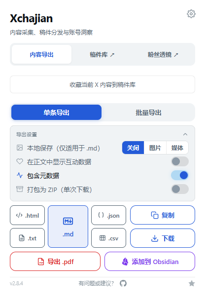

# Xchajian

将 X 内容导出、稿件采集分发和粉丝透镜整合到一个浏览器扩展中。

当前为 **pre-release 候选版本**，基于 XClipper 2.8.4、渡口 3.3.0 和 x-follower-lens 0.2.3。已完成本地检查及隔离 Chromium 验证；真实账号流程和 Firefox 实机运行仍需验收。此仓库是整合版，原项目商店安装包不包含这里的新增功能。

## 功能

| 功能区 | 能做什么 |
| --- | --- |
| 内容导出 | 单条/线程/文章与批量导出；Markdown、PDF、HTML、TXT、JSON、CSV；本地图片/媒体与 ZIP；Obsidian 保存 |
| 稿件库 | 当前 X 内容入库，微信/飞书链接采集，本地 Markdown 图文导入，历史稿件管理和 ZIP 下载 |
| 稿件分发 | 填入 X 文章、B站专栏草稿及公众号排版器；使用自行配置的飞书应用写入文档；可选本地终端桥 |
| 粉丝透镜 | 信息流/账号列表粉丝徽标、关注关系、规则标签、悬停或键盘详情、本地粉丝变化记录 |

UI 使用「内容导出 / 稿件库 / 粉丝透镜」三个入口；独立页面统一蓝白风格，稿件操作带文字标签，窄屏自动换行。已移除图形品牌 Logo，保留文字标题和功能图标。

## 界面预览

以下为实际扩展页面截图；稿件是隔离测试浏览器中的示例数据。



[粉丝透镜设置](docs/images/lens-settings.png) · [稿件库](docs/images/library.png) · [窄屏稿件库](docs/images/library-mobile.png) · [内容脚本效果（合成 X 页面）](docs/images/lens-on-x.png)

## 安装开发版

准备 Node.js 22.13+（建议 24）和 npm，然后执行：

```sh
git clone --branch pre-release https://github.com/zhuy3075-ui/Xchajian.git
cd Xchajian
npm ci
npm run build:chrome
```

1. 打开 Chrome / Edge 的扩展管理页面，开启开发者模式。
2. 点击「加载已解压的扩展程序」，选择生成的 `dist` 文件夹。
3. 打开 `https://x.com`；升级扩展后，重新加载扩展并刷新已打开的 X 页面。
4. 点击扩展按钮，选择「内容导出」「稿件库」或「粉丝透镜」。

Firefox 构建：`npm run build:firefox`，产物在 `dist-firefox`。最低 Firefox 128；当前只验证构建，尚未验证 Firefox 实机运行。仓库不提交 node_modules、dist 或浏览器用户数据，需自行构建；当前没有发布商店更新或 Release 安装包。

## 使用与配置

- **稿件库**：先采集或导入，再通过每篇稿件的文字按钮分发。X/B站填入草稿后由用户检查并发布。见 [稿件库说明](docs/dukou.md)。
- **粉丝透镜**：徽标默认开启，历史记录和列表淡化默认关闭。只处理 X 页面已经加载的数据，不主动抓取整份粉丝列表。规则标签和互动率仅描述已加载样本，不判断账号真实性。见 [粉丝透镜说明](docs/follower-lens.md)。
- **本地历史**：每个账号每 6 小时最多采样一次，最多 40 个点、3000 个账号；关闭总开关即停止采样，清空会使先前待写批次失效。
- **飞书**：按页面说明配置自己的应用；应用密钥仅保存在浏览器本地，未加密。所需权限由自己的飞书租户管理。
- **本地终端桥**：默认关闭，启用时单独授予 127.0.0.1 权限。见 [CLI 与桥说明](tools/dukou/README.md)。

> **首次连接 Obsidian 静默保存：** 在插件的 Obsidian 设置点击「连接仓库，启用静默保存」，核对仓库完整路径（当前为 `E:\x-obsidian\X智库`），选择对应的仓库根文件夹并允许写入。此操作使用 Chrome/Edge 的原生目录授权，浏览器若提供访问时长可选择始终允许；授权失效时重新连接。浏览器不提供所选目录的绝对路径，请自己核对文件夹位置。
>
> 主帖在「素材保存目录」沿用原路径/作者分组；目标必须在已连接仓库内。相对路径仍可用，填写的 Vault 名须与所选仓库一致。评论使用下述固定目录。Firefox 当前不支持此目录授权方式，会明确提示，仍可使用普通 Markdown/ZIP 导出。无需 Obsidian 插件、本地服务或剪贴板。

**评论/推文卡片一键保存：** 开启「在推文上显示内联按钮」后，点击卡片下载按钮旁的「笔记＋」，只保存点击的这一条，直接读取当前已加载内容，不打开作者主页或详情页。在讨论页采集其他评论时，一条评论一篇笔记，统一存到本地版指定的 `E:\x-obsidian\X智库\09_评论`，文件名固定为 `作者账号-评论ID.md`，不再按作者创建子文件夹；此评论路径独立于弹窗的主帖素材目录。主帖和首页普通卡片仍使用原有归档设置。保留正文、图片远程链接、作者、时间、评论原链接和采集时的讨论页链接，不采集相邻评论；引用内容保留被引用作者。评论笔记另附采集时间、单条范围说明及 `[[09_评论/评论索引|返回评论索引]]`；现有评论索引按 `09_评论` 目录自动汇总，新评论落盘后即可在阅读视图查看。正文仍显示「展开」或卡片仅为长文预览时，会提示先展开正文或使用文章页采集入口，避免将摘要当作全文。

**静默保存与结果提示：** 卡片、弹窗、文章页和右键的 Obsidian 入口直接写入已授权目录，不打开 Obsidian、不跳转应用、不因页面失焦而暂停。浏览器文件流关闭成功后才显示「保存成功」；页面提示约 3 秒后消失。未授权或写入失败时显示原因，卡片和弹窗保留正文及重试/连接入口，不自动回退到应用链接。

**同名笔记：** 同内容的已有文件直接复用；不同内容另存为 `作者-ID (2).md` 等编号文件。扩展内写入串行，检测到外部程序在写入期间更改文件会中止。浏览器 API 不提供跨应用原子锁，不应让其他程序同时写同一目标文件。重复采集的采集时间不同，因此可能另存快照，分析时仍按评论 ID 去重。

**完整长文：** 文章页操作栏和扩展弹窗保留全文采集。需要临时详情页的流程仍在结果交回原页面后关闭插件创建的临时页；用户自己打开的页面保持打开。采集失败、原页面不再接收或目标推文改变时保留临时页。

## 目录

```text
src/content/       X 页面提取与导出入口
src/background/    后台下载、批量任务与消息处理
src/popup/         主弹窗及导出设置
src/shared/        公用转换、设置与 Obsidian 逻辑
src/dukou/         稿件采集、管理、分发与平台适配器
src/lens/          粉丝透镜解析、展示、设置和历史记录
src/workbench.css  独立页面公共样式
tools/dukou/       可选本地桥及 CLI
docs/              使用说明、设计说明、变更明细和截图
```

## 开发与验证

```sh
npm run typecheck
npm run build:chrome
npm run build:firefox
```

本次公开推送按默认范围未包含 `tests/`、浏览器验收脚本及依赖这些测试的 CI 工作流；这些文件保留在开发者本地。因此新克隆可执行上述类型检查和构建，但当前不能在此公开快照直接复现 `npm test` 全套用例。

本地验证结果：459 项通过、9 项既有跳过；透镜新增 37 项测试。两组 Chromium 验收分别覆盖 5 组透镜/UI 检查和 8 项稿件流程检查，均无未捕获页面错误。部分上游测试缺少 HTML/GraphQL 夹具而跳过或提前返回，不能据此宣称真实 X 账号流程已全部验证。

静默保存专项：106 项相关用例通过，覆盖目录权限、路径边界、完成回包、失败重试、单评论归属与索引回链。隔离 Chromium 用合成 X 页面与 OPFS 真实文件句柄验证 IndexedDB 连接、后台写入/关闭/读回、失焦保存及同名保护，无页面错误。目录选择器使用测试替身；原生目录选择、权限续期和真实 Obsidian 仓库写入仍待用户验收。

详细实现、回归修复、验证范围及已知限制见 [本次整合变更说明](docs/changes/2026-10-10-integration.md)。

## 隐私与权限

数据默认保存在本地浏览器。分发稿件、写入飞书或下载远程图片时，会与所选目标服务通信。新增站点按需授权；透镜使用已有 x.com 范围，不新增必需权限。不提交应用密钥、访问令牌、个人浏览器配置和真实账户抓包数据。Obsidian 静默保存只访问用户在浏览器明确授权的仓库目录，目录句柄与对应路径保存在扩展本地 IndexedDB。为避免重复文件，会读取目标同名笔记进行比较；不扫描整个仓库、不上传笔记。现有 `clipboardWrite` 仅保留给复制等操作，Obsidian 保存不读写剪贴板。完整说明见 [PRIVACY.md](PRIVACY.md)。

## 来源与许可

- [XClipper](https://github.com/zendegani/XClipper)：PolyForm Noncommercial 1.0.0；Copyright © 2026 Ali Zendegani。见 [LICENSE.md](LICENSE.md)。
- [渡口](https://github.com/alchaincyf/dukou)：MIT，3.3.0；见 [来源与改动](src/dukou/NOTICE.md) 和 [许可](src/dukou/LICENSE)。
- [x-follower-lens](https://github.com/yaohongan/x-follower-lens)：MIT，0.2.3；见 [来源与改动](src/lens/NOTICE.md) 和 [许可](src/lens/LICENSE)。

整合不会把原 XClipper 许可变为 MIT；商业使用仍须遵守原项目许可要求。
