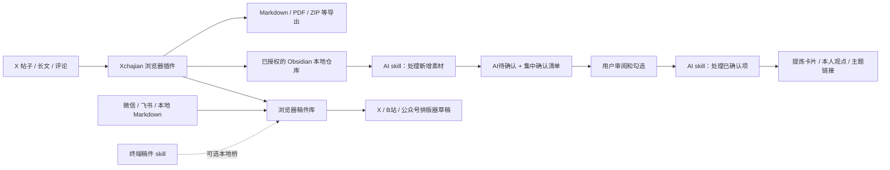

# Xchajian：X 内容采集、Obsidian 智库与稿件分发

把 X 上的帖子、长文和单条评论保存为自己的素材，在 Obsidian 中检索，让 AI 提炼、集中确认观点，再把稿件送到目标平台的草稿编辑器。

本仓库整合 **XClipper、渡口、x-follower-lens**，并附带 **Obsidian 空白智库模板、建库脚本和 AI skills**。克隆本仓库即可获得配套源码与资源，不必分别安装三个上游扩展。来源和许可证见[来源与许可](#sources)。

> 当前为 **pre-release 候选版本**，扩展基础版本为 2.8.4。推荐 Windows + Chrome/Edge；Firefox 提供构建，但不支持本版 Obsidian 静默写入。尚未发布商店安装包，也没有默认运行 AI 后台监听。本文针对本整合版，不能直接套用上游商店版的安装步骤。

## 导航

- [安装范围与运行要求](#requirements)
- [第一步：构建并加载浏览器插件](#extension)
- [第二步：安装 Obsidian 并创建智库](#vault)
- [第三步：连接仓库，完成首次保存](#connect)
- [第四步：安装与使用 AI skills](#skills)
- [插件各功能的详细使用](#usage)
- [可选：终端桥和稿件 skill](#bridge)
- [可选：飞书配置](#feishu)
- [更新、备份与换电脑](#maintenance)
- [常见问题](#troubleshooting)
- [验收清单、开发与验证](#verification)
- [来源、配套工作与许可](#sources)

## 工具怎样配合



| 组件 | 放在哪里 | 职责 |
| --- | --- | --- |
| Xchajian 浏览器扩展 | Chrome/Edge 加载 `dist` | 采集、导出、静默保存、粉丝透镜、稿件分发 |
| Obsidian 桌面软件与 Vault | 自己选择的普通文件夹 | 阅读 Markdown、搜索、双链、模板、确认清单 |
| AI skill | 本仓库 `.agents/skills` 或 AI 工具的技能目录 | 指导有文件读写能力的 AI 建库、提炼与入档 |

**普通采集与保存不需要 AI、API Key、数据库、Docker、服务器或 Obsidian 社区插件。** AI 提炼需要自己的 AI 工具和模型访问；终端投稿才需要可选本地桥。浏览器稿件库与磁盘智库是两个存储区，不会自动双向同步。

<a id="requirements"></a>
## 安装范围与运行要求

| 你想做什么 | 需要安装 | 阅读范围 |
| --- | --- | --- |
| 看发文时间/粉丝数据、下载帖子 | Node.js + 浏览器扩展 | 第一步 |
| 一键保存主帖和评论到智库 | 上述 + Obsidian + 空白库 | 第一步至第三步 |
| AI 提炼、集中确认、正式入档 | 上述 + Python + 可用的文件型 AI + 素材库 skill | 第一步至第四步 |
| 从终端送稿/取稿 | 浏览器扩展 + Node 本地桥 + 稿件 skill | 另读可选终端桥 |
| 读写飞书文档 | 浏览器扩展 + 自己的飞书应用 | 另读飞书配置 |

完整安装顺序：**构建扩展 → 创建并打开智库 → 授权目录 → 保存短帖 → 检查索引 → 启用 skill → 提炼一篇 → 确认入档 → 按需启用桥。** 遇到问题从对应检查点继续，不必重装整套。

本指南命令以 **Windows PowerShell 7** 为例。Node 和 Python 脚本可用于其他桌面系统，macOS/Linux 请换成自己的 `/Users/...` 或 `/home/...` 路径；这些系统上的完整交互未做实机验收。

| 项目 | 要求 | 检查方法 / 官方入口 |
| --- | --- | --- |
| Git | 能访问 GitHub；也可下载 `pre-release` 分支 ZIP | `git --version`；[Git 下载](https://git-scm.com/downloads) |
| Node.js / npm | Node 22.x 至少 22.22.2，或 24.x 至少 24.15.0；推荐符合要求的 24.x，使用仓库锁文件 | `node --version`、`npm --version`；[Node 下载](https://nodejs.org/en/download) |
| 浏览器 | Chrome/Edge 桌面版，可加载 Manifest V3 开发扩展并授权目录 | [Chrome](https://www.google.com/chrome/) / [Edge](https://www.microsoft.com/edge) |
| Obsidian | 桌面版，有自己可写的本地仓库 | [官方下载](https://obsidian.md/download) |
| Python | 3.10+，仅建库脚本需要；只用标准库 | `python --version`；[Python 下载](https://www.python.org/downloads/) |
| 文件型 AI | 需要 AI 提炼时安装，能读写目标库，有自己的账户/模型配置 | [Codex 官方安装指引](https://learn.chatgpt.com/docs/codex/cli) |
| 网络和账户 | 来源站可访问，分发时登录目标平台 | X Articles 需账号具有文章编辑资格 |
| 磁盘空间 | 源码、依赖、浏览器数据与笔记/媒体均需空间 | 媒体体积取决于采集量，不承诺固定容量 |

这是本机部署：浏览器、磁盘库和可选本地桥在同一台电脑。云端 AI 通常不能直接写本机 Vault，也不能代替用户点击原生目录授权。组织管理的浏览器若限制开发者扩展或文件权限，应按组织规则处理。

请将源码与私有素材分开，例如：

```text
C:\Tools\Xchajian           ← 源码、构建文件、skills
D:\Knowledge\我的智库       ← 私有 Markdown、附件与 Obsidian 配置
```

以下路径都是示例，请替换为实际路径，不要求存在 D 盘。不要把个人素材库放进公开 Git 仓库。

<a id="extension"></a>
## 第一步：构建并加载浏览器插件

### 1. 获取本整合版

在希望保存源码的父目录打开终端：

```powershell
git clone --branch pre-release https://github.com/zhuy3075-ui/Xchajian.git
cd Xchajian
npm ci
if ($LASTEXITCODE -ne 0) { throw '依赖安装失败，请先处理上方错误' }
npm run build:chrome
if ($LASTEXITCODE -ne 0) { throw '构建失败，请先处理上方错误' }
Test-Path ./dist/manifest.json
```

最后应输出 `True`。`npm ci` 按 `package-lock.json` 安装依赖；不要删除锁文件来绕过错误。若下载 ZIP，请在 GitHub 先切到 `pre-release` 分支，解压后在有 `package.json` 的目录执行安装与构建。

### 2. 在浏览器加载

1. Chrome 打开 `chrome://extensions`，Edge 打开 `edge://extensions`。
2. 开启“开发者模式”，点击“加载已解压的扩展程序”。
3. 选择 **`Xchajian/dist`**，不要选源码根目录、`src` 或上游的 `extension`。
4. 固定到工具栏。扩展名称仍可能显示 **XClipper**，请用加载路径确认是本整合版。
5. 打开并登录 `https://x.com`，按提示允许所需站点访问，刷新 X。

**检查点：** 弹窗直接显示设置与连接状态；X 页面每条帖子下有“保存到 Obsidian / 复制正文 / 下载”，下载旁的小箭头打开导出选项；页面角落有“采集工具”。粉丝透镜设置也在同一弹窗内。旧用户若曾关闭页面按钮，请打开弹窗顶部“显示页面操作控件”。更新扩展后，已打开的 X 标签可能仍使用旧脚本；弹窗会提示并提供“刷新当前 X 页面以应用更新”，请先保留未发送草稿再点击。不要同时启用重复的 XClipper / 原渡口实例。

### 3. Firefox 开发测试（可选）

执行 `npm run build:firefox`，在 Firefox 128+ 的 `about:debugging#/runtime/this-firefox` 加载临时附加组件，选择 `dist-firefox/manifest.json`。临时加载不是永久安装；当前只验证构建。**Firefox 不支持本版目录授权静默保存**，改用 Markdown/ZIP 导出。没有 Safari/手机浏览器安装包。

<a id="vault"></a>
## 第二步：安装 Obsidian 并创建智库

### 1. 安装 Obsidian

从[官方下载页](https://obsidian.md/download)安装桌面版。Vault 本质是本地文件夹，不是 GitHub 仓库，也不是浏览器稿件库。[官方说明](https://obsidian.md/help/manage-vaults)

### 2. 用随仓脚本建立空白结构

从 Xchajian 源码根目录运行，先修改路径和库名，首次建议选一个新目录：

```powershell
$vaultPath = 'D:\Knowledge\我的智库'
$vaultName = '我的智库'
$createdDate = Get-Date -Format 'yyyy-MM-dd'
$initScript = '.agents/skills/obsidian-content-vault/scripts/init_vault.py'

# 只预览，不写入
python $initScript --vault $vaultPath --name $vaultName --date $createdDate
if ($LASTEXITCODE -ne 0) { throw '预览发现错误或冲突，停止创建' }

# 创建并预设模板目录
python $initScript --vault $vaultPath --name $vaultName --date $createdDate --apply --configure-templates
if ($LASTEXITCODE -ne 0) { throw '建库未完成，请检查报告' }

# 只验证结构与双链
python $initScript --vault $vaultPath --verify
if ($LASTEXITCODE -ne 0) { throw '结构检查未通过，请检查报告' }
```

Windows 若只提供 `py`，将 `python` 改为 `py -3`，先确认版本至少 3.10。脚本不安装 Obsidian、AI 工具或社区插件。

默认生成14个功能目录、收件箱的两个子目录、32篇 Markdown、8个模板、4套任务提示词及可选模板配置。以实际报告为准；成功时 `verification.errors` 为空，退出码为0。

已有库可先预览。脚本不覆盖同名不同内容，遇到冲突在写入前以退出码2停止；不要清空原库，先读差异再按需合并。重复创建用相同名称与日期；日常检查使用 `--verify`，不要每天重新初始化。

### 3. 打开仓库与核心功能

在 Obsidian 选择“打开文件夹作为仓库 / Open folder as vault”，指向上面的目录，打开 `VAULT_INDEX.md` 并加入书签。在“设置 → 核心插件”确认搜索与模板可用，模板目录设为 `90_模板`。[模板说明](https://obsidian.md/help/plugins/templates)

**无需 Dataview、Templater 或 Local REST API，也不必为此关闭受限模式。** `--configure-templates` 只新增缺失的 `.obsidian/templates.json`，不会启用插件或覆盖现有设置；已有配置保留时手动核对模板目录。

### 4. 目录用途

```text
我的智库/
├─ VAULT_INDEX.md                 首页
├─ 00_导航/                      使用规则、集中确认清单、处理台账
├─ 01_收件箱/
│  ├─ 原始素材/                  其他待整理来源
│  └─ AI待确认/                  AI提炼与候选观点
├─ 02_X素材/                     主帖和文章，可按作者分目录
├─ 03_提炼卡片/                  已确认采用的摘要、案例和方法
├─ 04_观点库/                    本人明确认同的判断
├─ 05_思考日志/                  疑问、联想和判断变化
├─ 06_主题地图/                  跨素材双链组织
├─ 07_创作工作台/                选题、提纲与草稿
├─ 08_博主档案/                  有实际样本依据的作者观察
├─ 09_评论/                      单条评论平铺保存
├─ 90_模板/                      8种笔记模板
├─ 91_AI工作流/                  归档协议、4套任务提示词
├─ 98_附件/                      自己整理的附件
└─ 99_归档/                      暂不使用的资料
```

**检查点：** 首页能进入 X 素材、评论和集中确认清单。空库显示空列表正常；模板不会预填真实素材或虚构个人观点。

<a id="connect"></a>
## 第三步：连接仓库，完成首次保存

### 1. 填写保存设置

在“内容导出”的 Obsidian 设置中，建议新用户使用相对目录：

| 配置 | 示例 | 含义 |
| --- | --- | --- |
| Vault 名称 | `我的智库` | 与选择的根文件夹名称完全一致 |
| 素材保存目录 | `02_X素材` | 仓库内主帖/文章目录 |
| 按博主账号建立文件夹 | 开启 | 例如 `02_X素材/author/`，不以昵称分组 |
| 在推文上显示内联按钮 | 开启 | 卡片出现保存及复制入口 |

也支持 `D:\Knowledge\我的智库\02_X素材` 这样的完整素材路径，但必须在已连接库内。**连接页选择仓库根目录 `我的智库`，不要选择 `02_X素材`。**

### 2. 完成原生目录授权

1. 点击“连接仓库，启用静默保存”。
2. 输入根目录完整路径，例如 `D:\Knowledge\我的智库`。
3. 在浏览器文件夹选择器中选择同一根目录，允许读写。
4. 连接成功后返回 X。若由保存失败提示进入连接页，保持原页面打开，返回后会自动继续；否则重新点击目标卡片保存。

根目录须有 `.obsidian`，所以应先在 Obsidian 打开并初始化。浏览器不提供所选文件夹绝对路径，扩展只能核对目录名等信息；存在同名库时请自己核对选择器实际位置。授权期限由浏览器决定，过期重新连接。

### 3. 保存短帖，再保存单条评论

点击完整短帖操作栏的“笔记＋”。成功提示显示库内实际文件位置，约5秒后消失。文件写入、关闭并读回一致才报告成功；不打开 Obsidian，不逐篇再次确认。

在讨论页点击某条评论自身的“笔记＋”：

```text
主帖：02_X素材/作者账号/文件名.md
评论：09_评论/评论者账号-评论ID.md
```

评论目录相对于**当前连接的仓库**，不依赖维护者盘符，不跟随主帖作者分组。重复评论按自身来源ID跳过，保留首次快照和个人编辑；采集时间、互动数、作者改名不产生新副本。旧重复文件不自动删除。

评论识别依据当前讨论页与所点卡片的原链接：讨论页中原链接不同的卡片按评论处理。在主页时间线采集回复，或将该回复单独打开为页面主帖时，可能按主帖归档；当前不会联网查询整条对话树来推断所有回复身份。

### 4. 检查索引

打开 Obsidian 首页的“X素材”或“评论库”，切到阅读视图。索引用核心搜索自动覆盖子目录，不要求插件生成中文类型字段，也不用逐篇手工登记：

```query
path:"02_X素材/" -file:"X素材索引"
```

```query
path:"09_评论/" -file:"评论索引"
```

出现在索引里只表示“已收集”，不表示 AI 已提炼或观点已核验。[搜索语法](https://obsidian.md/help/plugins/search)

**检查点：** 文件管理器能找到提示位置的 `.md`，正文和原链接正确；对应索引可列出。成功提示证明磁盘读回通过，不保证 Obsidian 当前视图已刷新。

<a id="skills"></a>
## 第四步：安装与使用 AI skills

### 1. 配套技能与安装位置

| Skill | 仓库资源 | 用途 |
| --- | --- | --- |
| `obsidian-content-vault` | [SKILL.md](.agents/skills/obsidian-content-vault/SKILL.md) | 建库、处理新增素材、集中确认、正式入档 |
| `xchajian-dukou` | [SKILL.md](.agents/skills/xchajian-dukou/SKILL.md) | 通过本仓库CLI送稿/取稿，按请求填入草稿 |

第一个来自配套智库搭建工作；第二个是本仓库 `.cjs` CLI 的使用适配。开发时使用过的代码审查、Git管理等技能不是最终用户依赖，不必全部安装。粉丝透镜不需要AI；本方案不要求Scweet/MCP或额外X抓取服务。

先按[Codex官方指引](https://learn.chatgpt.com/docs/codex/cli)安装并登录。桌面用户将 **Xchajian源码目录**作为本地项目打开；CLI用户在该目录运行 `codex`。不用把模型Key填到扩展里。

Codex支持仓库 `.agents/skills` 与用户 `~/.agents/skills`。本仓库已放置前者，新建本地会话后查看技能列表或直接用 `$obsidian-content-vault` 调用。[官方技能目录说明](https://learn.chatgpt.com/docs/build-skills)

第一次这样说，替换路径：

```text
使用 $obsidian-content-vault。
目标库是 D:\Knowledge\我的智库，已经建好结构。
读取首页、归档协议和集中确认清单，检查能否读取与写入。
不要重新建库、移动原文或安装其他插件。
```

库在代码目录外时，按AI工具自身流程把它加入可访问范围。**发现skill不等于拥有文件权限**，不要全局关闭权限控制来排错。

### 2. 需要跨项目使用时（可选）

默认仓库级方式已够用。若要从素材库目录启动Codex，可以把自包含的素材库技能复制到用户技能目录。从源码根目录运行；已有同名技能会停止，保留你的定制版本：

```powershell
$skillSource = Join-Path (Get-Location) '.agents/skills/obsidian-content-vault'
$skillHome = Join-Path $HOME '.agents/skills'
$skillTarget = Join-Path $skillHome 'obsidian-content-vault'
if (Test-Path -LiteralPath $skillTarget) { throw '同名技能已存在，请先比较版本' }
New-Item -ItemType Directory -Path $skillHome -Force | Out-Null
Copy-Item -LiteralPath $skillSource -Destination $skillTarget -Recurse
```

重新打开会话。避免同一项目同时维护多个同名skill；旧环境已有 `~/.codex/skills` 版本时，先核对实际发现位置。`xchajian-dukou`依赖仓库工具，推荐留在仓库；全局使用须明确源码实际路径。

其他AI工具可按自身官方技能机制加载，或要求它读取 `SKILL.md`。只有聊天、没有文件工具的AI无法自动落盘、计算真实文件哈希或移动卡片。本项目未预装Obsidian Copilot/Text Generator，也未提供其专用适配。

### 3. 日常使用：两句话与一次集中确认

**第一句：处理新增素材。**

```text
使用 $obsidian-content-vault，处理 D:\Knowledge\我的智库 中的新增素材。
先处理最多10篇；提炼结果自动保存到AI待确认，更新集中确认清单。
保留原文，不把AI候选标为我的观点。
```

AI扫描 `02_X素材`、`09_评论`、`01_收件箱/原始素材`，排除索引，按来源和实际内容去重，默认每批最多10篇。结果保存到 `01_收件箱/AI待确认`；清单附摘要、来源、缺口、候选及来源的真实SHA-256。没有新增或可复用点时不制造空卡片。

**在Obsidian打开 `00_导航/集中确认清单.md`，集中审阅：**

| 操作 | 批准的含义 | 目标 |
| --- | --- | --- |
| 保留提炼并入档 | 卡片有保留价值，不表示认同作者全部主张 | `03_提炼卡片` |
| 认同此观点并入档 | 明确认同这一条判断，可作为本人观点 | `04_观点库` |
| 写修改意见或不勾选 | 暂不批准 | 保持待确认 |
| 标为退回 | 不采用，保留理由 | 不自动删除 |

**第二句：处理已确认项。**

```text
使用 $obsidian-content-vault，处理 D:\Knowledge\我的智库 中已确认的项目。
核对候选和来源版本，仅将我在集中确认清单批准的内容入档。
更新属性、受影响的双链与台账，不移动或删除原文。
```

确认后文件变化会暂停该项，不能用旧勾选批准新内容。实际落盘和链接更新成功才算完成；“采用卡片”与“事实已经外部核验”是不同状态。

**当前是“发指令后批量执行”。** 导入文件、打开Obsidian或勾选清单不会启动后台任务；没有默认计划任务、监听器或自动发布。要接其他执行器需单独验证文件权限、触发方式和确认边界。

### 4. 模板和工作流

8种模板是X素材、X评论、提炼卡片、个人观点、思考日志、主题地图、创作选题、博主档案。原始剪藏无需逐篇套中文模板。

4套任务提示词在 `91_AI工作流`：单篇提炼、确认后入档、跨素材综合、批量新增处理。先读 `AI归档协议.md`。有文件读写能力的Obsidian AI插件可复用协议，但需要自己配置模型与读取范围；文件存在不等于插件已接入。

<a id="usage"></a>
## 插件各功能的详细使用

### 单条、批量与离线导出

所有内容操作都在 X 页面完成，插件弹窗只保留设置、仓库连接与状态。

| 页面入口 | 使用方式 |
| --- | --- |
| 保存到 Obsidian | 点击所需帖子或评论，静默写入已连接仓库；以写入回执为准显示路径，失败保留重试入口 |
| 复制正文 | 复制该条自身的纯文本，不含引用帖，不受导出格式影响 |
| 下载 | 单击后直接按弹窗“导出设置 → 单条导出 → 默认单条格式”下载；无需再次确认格式 |
| 下载旁的小箭头 | 打开导出选项，选择 Markdown、TXT、HTML、JSON、CSV 或 PDF；选择范围或“复制为所选格式”。菜单中选择的格式会成为后续单条默认值 |
| 页面“采集工具” | 手动勾选多条、导出当前已加载列表，或按已配置策略自动翻页；查看进度、暂停/继续普通任务、停止任务 |

导出默认“仅此条”。需要同作者完整线程时，在导出菜单明确选择“完整线程（尽力补全）”；其他人的回复不在该范围内。长文/折叠预览会通过插件创建的临时详情页补全，导出后释放临时页；刷新/关闭原页面会中止该次导出并释放临时页。不会关闭自己原来打开的阅读页。PDF 走打印预览，仍需在浏览器选择另存为 PDF，不提供复制或批量 PDF。

批量默认只处理当前页面已加载过的列表，不自动翻页。需要自动采集时，先在插件弹窗的“导出设置 → 批量”配置采集模式、日期和输出，再在页面面板选择“按设置自动翻页”，核对范围后开始。自动方式只支持书签、喜欢和主页，需既有可选权限及 X 登录会话；时间线和手动选择使用普通采集。收起面板不停止任务，再展开仍可查看进度。重置导出记录需确认，不删除文件，但再次采集可能重复下载。批量导出沿用原来的线程补全规则；需要逐条评论入库时使用评论自身的保存按钮。

弹窗中单条/批量切换仅用于调整**默认设置**：格式、本地媒体、互动数据、元数据、ZIP、转帖、输出方式、采集模式和日期。单条下载使用单条格式，批量格式不影响单条。通用选项共用已有设置值；粉丝透镜与仓库偏好保持独立。“页面控件位置”同时调整帖子下方的插件按钮和悬浮采集工具，已加载页面即时生效；X 原生按钮之间的顺序保持不变。历史“下载按钮改为复制”的入口已移除，旧值保留用于兼容。

要离线图片，选择 Markdown，开启本地图片/媒体与 ZIP。解压后保留文件和同包附件目录。**静默保存只写 Markdown 及远程媒体链接，不等于离线媒体打包**；长期离线图文优先走 ZIP。视频未能解析时会提示保留链接。下载提示“已发起下载”，不等于文件已完整落盘。

### 时间线与评论

- “笔记＋”：保存所点卡片。完整卡片直接采集；时间线折叠长帖/文章预览使用插件创建的临时详情页，成功交接后关闭。
- 评论区：仅采集所选评论及引用信息，尝试原地展开，不打开作者主页，也不批量抓整区评论。
- 双页“复制正文”：复制卡片自身纯文本，保留换行表情，不附加作者、互动数、图片或邻居评论；无法原地展开的全文需先进入详情。
- 发文时间：本地时区、24小时制 `MM-DD HH:mm`，跨年补年份，悬停显示秒和时区；没有有效原始时间的节点保持原样。

临时页在采集/交接失败时可能保留供检查；自己打开的页面不会因保存自动关闭。主帖同名同内容复用，不同内容另存编号文件；评论ID去重保留首次记录与个人编辑。

### 粉丝透镜

时间线只显示粉丝数和与你的关系。悬停、点击或键盘聚焦后查看关系、粉丝/关注人数、粉丝变化、注册月份和互动表现，已移除更多数据展开区。

徽标默认开启，历史和列表淡化默认关闭。历史仅在浏览取得数据时采样，每账号每6小时最多一次、40个点，总计最多3000账号。基准需距本次读取至少20小时，优先接近7天前；“比约N天前多/少”是两次记录差，不是今日新增或持续监控。

关系来自X返回的数据。账号列表的关注倾向仅描述数量，不代表影响力、真实性或回关意愿；样本浏览量不足2000时显示“暂无法判断”。当前互动样本不等于长期账号表现。[详细说明](docs/follower-lens.md)

### 稿件库与平台草稿

主弹窗已移除稿件库和当前 X 内容入库功能入口。已有稿件及可选终端桥仍保留；高级用户可在扩展管理页查看本扩展 ID，然后打开 `chrome-extension://<扩展ID>/dukou/popup.html` 访问独立稿件页，建议收藏该页。以下稿件与桥说明均针对该独立页面。

独立稿件页可粘贴微信/飞书链接采集，或导入Markdown与图片。X内容可先导出Markdown后按需导入。浏览器只能读你选择的文件：多选正文和附件，或选整个目录；图片用独占一行的相对链接。首次来源与目标站访问会申请权限，取消则不继续操作。

| 目标 | 条件 | 操作结果与需要检查的内容 |
| --- | --- | --- |
| X Articles | 登录、有文章编辑资格，点Write新建草稿 | 填入标题正文图片，检查封面与上传结果后自行发布 |
| B站专栏 | 登录并打开可用编辑器 | 检查适配结果和网站提示，自行保存/发布 |
| 公众号排版器 | `editor.huasheng.ai` | 填入Markdown，不等于发布公众号文章 |
| 飞书 | 自己的应用与权限 | 创建云文档，不属于网页草稿填入 |
| ZIP下载 | 稿件已入库 | Markdown及图片备份 |

填入结束面板约1.5秒收起，异常保留提示；收起不证明网站已保存，更不表示发布。相同稿件ID会更新库内版本，需要历史版先导出。复杂表格、嵌套结构和平台附件可能无法完整转换。[稿件说明](docs/dukou.md)

### 界面参考

以下为早期整合候选版的实际扩展截图，使用隔离测试数据；部分文案与粉丝卡片已更新，以本文和当前构建为准。

新版入口见上文操作说明；下图为早期界面参考，不代表当前操作位置。


[稿件库](docs/images/library.png) · [窄屏稿件库](docs/images/library-mobile.png) · [粉丝设置参考](docs/images/lens-settings.png)

<a id="bridge"></a>
## 可选：终端桥和稿件 skill

本地桥用于终端与浏览器稿件库交接，**Obsidian静默保存不需要它**。CLI和服务在 `tools/dukou/scripts`，只依赖Node标准库，不需单独安装依赖，也不用上游的`.js`路径。

### 启用与验证

1. 在稿件页“更多设置与使用说明”开启本地终端桥，允许访问`127.0.0.1`。
2. 保持浏览器运行。分发前在库内点对应目标按钮，完成站点授权和登录。
3. 在源码根目录运行：

```powershell
node tools/dukou/scripts/dukou.cjs ping
```

没有服务时CLI会自动后台启动，固定地址 `http://127.0.0.1:8787`。**ping只证明服务在线，不证明扩展已开启桥或取到任务。** 首次用无敏感内容的稿件只入库验证。

### 常用命令

替换实际文件、文章链接和输出目录，从源码根目录执行：

```powershell
# 只入库
node tools/dukou/scripts/dukou.cjs send 'D:\稿件\示例.md' --dest none

# 填入草稿，X仍需手动点Write
node tools/dukou/scripts/dukou.cjs send 'D:\稿件\示例.md' --dest x --autofill
node tools/dukou/scripts/dukou.cjs send 'D:\稿件\示例.md' --dest bili --autofill
node tools/dukou/scripts/dukou.cjs send 'D:\稿件\示例.md' --dest editor --autofill

# 仅支持微信fetch；替换为实际文章链接
node tools/dukou/scripts/dukou.cjs fetch 'https://mp.weixin.qq.com/s/实际文章ID' --save-to 'D:\稿件\导出'

# 默认导出最新一篇，可用 --id 指定稿件ID
node tools/dukou/scripts/dukou.cjs export --save-to 'D:\稿件\导出'
```

`send/export`默认等约90秒，`fetch`约240秒，可加`--wait 秒数`。超时先查看库内、目标草稿和输出目录，避免重复发送。启用后约每30秒同步，打开稿件页也会同步。飞书采集使用插件页面，不用fetch CLI。

Markdown首个`# 标题`或frontmatter `title`作为标题；本地图片用相对路径独占一行。可用`--title`、`--cover`覆盖标题与封面：

```markdown
---
title: 示例稿件
author: 你的署名
---

正文第一段。


```

### 让 AI 操作

在本仓库的本地AI会话中说：

```text
使用 $xchajian-dukou，把 D:\稿件\示例.md 送入稿件库，暂不分发。
```

需要分发时明确指定草稿目标。该技能读取本仓库CLI，不安装原渡口扩展，也不包含最终发布授权。

### 进程、日志与部署边界

- 不用时关闭扩展桥开关停止轮询，后台服务可能仍运行。
- 自动启动日志在系统临时目录 `xclipper-dukou-bridge.log`。
- 若希望自行管理，先手动运行 `node tools/dukou/scripts/server.cjs --dir 'D:\稿件\导出'`，用`Ctrl+C`停止。服务已由CLI启动时，先核对对应`server.cjs`进程再结束，避免关闭其他Node程序。
- 不与原渡口桥同时启用。不要仅改`DUKOU_PORT`，插件固定访问8787，端口占用应先排查。
- 桥信任本机终端和扩展，不提供多用户认证；不部署公网、不映射容器端口、不作为云API。

协议与限制见[本地桥说明](tools/dukou/README.md)。

<a id="feishu"></a>
## 可选：飞书配置

不用飞书可跳过，其他功能不需要飞书密钥。

1. 在[飞书开放平台](https://open.feishu.cn/)管理自己的应用。
2. 按需要配置文档读写、素材上传下载和协作者权限。上游基础scope为`docx:document`、`drive:drive`、`docs:permission.member:create`；wiki还需核对知识库访问范围与节点接口权限，不能只填密钥就视为齐备。[上游说明](https://github.com/alchaincyf/dukou)
3. 按租户要求发布/启用应用并取得管理员批准，确保应用能访问待采集文档。
4. 在稿件页填写自己的`app_id`、`app_secret`、用于授予编辑权限的`open_id`并保存。
5. 先测试无敏感内容文档的读取，再测试创建，分别检查正文、图片和本人编辑权限。

凭据保存在扩展本地存储，**未加密**。不要在共享浏览器保存高权限密钥，不要提交GitHub或放入截图/笔记；清空保存可移除配置。凭据获取和实际权限以[飞书官方文档](https://open.feishu.cn/document/home/index)为准。

读取主要支持文本类块和图片，表格、画板、附件不保证转换。创建后图片或权限失败可能已留下部分文档，先打开报告链接，重试可能新建另一份。真实租户流程需安装者验收。

<a id="maintenance"></a>
## 更新、备份与换电脑

### 更新

保留原源码目录。没有个人代码改动时执行：

```powershell
git status --short
git pull --ff-only origin pre-release
if ($LASTEXITCODE -ne 0) { throw '更新失败，先处理本地改动或分支分歧' }
npm ci
if ($LASTEXITCODE -ne 0) { throw '依赖安装失败' }
npm run build:chrome
if ($LASTEXITCODE -ne 0) { throw '构建失败' }
```

然后重新加载扩展、刷新X和目标编辑器页。不要先卸载：卸载、换浏览器配置或加载路径可能导致本地稿件、设置、历史与目录授权不可用。有个人代码改动先保存，`--ff-only`失败不要强制重置。

技能模板更新不自动改写旧库，需要AI比较后最小合并，不重新初始化覆盖笔记。

### 备份范围

| 数据 | 位置 | 处理 |
| --- | --- | --- |
| 素材、评论、候选、观点、附件 | Vault | 备份整个库，保持相对附件路径 |
| Obsidian设置 | `.obsidian` | 私有备份；其他插件配置可能含凭据 |
| 浏览器稿件库 | 扩展本地存储 | 逐篇ZIP或按ID桥导出；不带ID仅导出最新一篇 |
| 插件设置、粉丝历史、目录句柄 | 浏览器配置 | 不在Git克隆内，新电脑重新设置授权 |
| skills | 本仓库/用户技能目录 | 仓库版可再克隆，保留个人定制 |

换电脑后重新加载扩展、打开备份库、连接授权；旧目录句柄不能充当新电脑授权。保存期间避免其他编辑器或同步程序同时写同一笔记。

<a id="troubleshooting"></a>
## 常见问题

| 现象 | 处理 |
| --- | --- |
| 找不到node/npm/python | 安装对应运行时、重开终端检查版本；可选组件不用就跳过 |
| npm提示EBADENGINE | 核对实际Node小版本；仅22.13或24.0不满足当前锁文件，升级到22.22.2+的22.x或24.15.0+的24.x |
| PowerShell拒绝npm.ps1 | 同位置改用`npm.cmd`，不用全局关闭执行策略 |
| 找不到manifest | 先构建成功，加载`dist`而不是源码根目录 |
| 新功能没出现 | 核对加载路径不是上游商店版，重新加载扩展并刷新X |
| 时间线无保存按钮 | 开启内联按钮；在弹窗顶部开启“显示页面操作控件”，刷新 X 页面，再点目标卡片 |
| 更新后还看到旧导出弹窗 | 确认加载的是本仓库最新 dist，重新加载扩展并刷新 X 页面；新弹窗只有设置与状态 |
| 提示连接仓库 | 先在Obsidian打开库并确认`.obsidian`存在，再原生目录授权；输入路径不等于授权 |
| 目录名不一致/不在库内 | 核对选择器根目录、填写路径与Vault名；相对主帖目录建议`02_X素材` |
| 重试仍失败 | 先修复权限/连接/路径原因；未连接时直接连接，不连续重试 |
| 成功但首页没显示 | 按提示路径在磁盘查找，进入X素材/评论对应索引阅读视图；`02_X素材`不在收件箱查询内；核对同名库 |
| 评论没进09_评论 | 在讨论页点评论自身按钮；主页回复或单独打开为主帖时可能按主帖处理 |
| 重复评论没新文件 | 查看“已保存，无需重复保存”指向的旧文件，不覆盖个人编辑 |
| 保存仍弹Obsidian或剪贴板提示 | 当前写入不用URI/剪贴板，检查旧版或上游扩展是否仍启用 |
| 采集不完整 | 确认可访问，允许临时详情页加载；失败检查保留页，不把摘要当全文 |
| 图片离线打不开 | 静默保存是远程图链接，需要离线图文用Markdown+本地图片+ZIP |
| 索引是代码/空白 | 切阅读视图，启用核心搜索，核对目录名与实际文件，无需Dataview |
| 建库conflicts/退出码2 | 保护已有不同内容，读差异再合并，不删库重建 |
| AI找不到skill | 在源码项目的新本地会话查找，或提供SKILL.md路径；核对重复安装与技能目录 |
| AI只回复不写入 | 确认是文件型本地AI，库在可访问范围内，明确要求执行 |
| 勾选后没入档 | 还需发“处理已确认项”，没有后台监听 |
| 粉丝变化等待记录 | 历史默认关闭，开启后需有足够时间跨度的浏览采样 |
| 互动暂无法判断 | 样本不足，不代表账号没有互动 |
| 桥ping成功但任务超时 | 检查扩展开关、localhost权限、浏览器运行情况；打开稿件页，再查日志与实际结果 |
| 8787冲突 | 检查现有桥或其他进程，不同时运行两个消费者，也不只改CLI端口 |
| 飞书权限错误 | 核对应用、访问范围、租户审核和返回错误，先确认是否已创建部分文档 |
| X/B站填入失败/图片不全 | 核对登录、资格、新草稿及目标站权限，查看面板；网站结构变化可能需适配 |

报告问题请提供系统/浏览器、分支和`git rev-parse --short HEAD`、入口、错误原文、是否重载。隐去密钥与私人笔记，不上传浏览器配置、令牌或整个私有库。

<a id="verification"></a>
## 验收清单、开发与验证

### 新安装验收

- [ ] 构建成功，加载本仓库`dist`，弹窗只有设置与连接状态，粉丝透镜设置可展开；页面三个按钮及采集工具可用，导出菜单的格式下拉框可用。
- [ ] 空白库`--verify`无错误，首页/索引可打开。
- [ ] 授权目录后保存短帖，在磁盘读到正确正文及来源。
- [ ] 讨论页评论进入`09_评论`，重复点击不新增副本。
- [ ] 主帖按作者进入`02_X素材`，对应索引能查到。
- [ ] 保存不弹Obsidian，复制只改剪贴板。
- [ ] AI可选：一篇素材生成候选清单，确认后才正式入档。
- [ ] 桥可选：先`--dest none`入库，再测试目标草稿。
- [ ] 飞书可选：读取、创建、图片、编辑权限分别检查。

### 开发命令

```powershell
npm ci
npm run typecheck
npm run build:chrome
npm run build:firefox
```

公开快照尚未随附完整`tests/`和浏览器验收脚本；`package.json`中的`npm test`不是新克隆可完整复现的测试承诺。开发者本地历史测试覆盖静默写入/读回、重连、评论去重、复制、时间显示、粉丝卡片和稿件桥；曾用隔离Chromium、合成页面与文件句柄做交互验证。[历史变更说明](docs/changes/2026-10-10-integration.md)

建库脚本`--verify`可公开复现，但只检查随附结构及链接，不证明外部来源真实，也不替代Obsidian界面验收。Windows是开发验证主环境；真实X/微信/B站/飞书账户、Firefox实机、其他系统与AI提炼质量需在使用环境验收。

本次部署文档整理已在独立工作目录执行`npm ci`、类型检查和双构建；建库预览不写入、实际创建、重复执行不覆盖、32篇文档/8模板/74处双链验证通过。评论相对目录与保存相关92项本地测试通过。原生浏览器授权、真实平台登录和AI入档仍需按上方清单验收。

2026-10-11 的`npm audit`报告一项已有开发依赖告警：`source-map-js@1.2.1`（由jsdom/css-tree与vitest/vite/postcss引入），[GHSA-68fv-2mgg-jv7q](https://github.com/advisories/GHSA-68fv-2mgg-jv7q)。这是源映射处理相关的高危拒绝服务告警；构建通过不代表审计通过。本次没有更改依赖锁文件，更新依赖应单独验证，不建议直接盲跑`npm audit fix --force`。

### 源码与数据

```text
src/content/                 X正文、评论、临时详情页与时间线入口
src/shared/                  设置、转换、Obsidian路径与文件写入
src/background/              后台下载、采集协调与写入消息
src/obsidian-connect/         原生目录连接
src/popup/                   设置、仓库连接与粉丝透镜配置
src/page-tools/              嵌入 X 页面的导出菜单与批量面板
src/dukou/                   稿件库、平台适配、飞书
src/lens/                    粉丝透镜、设置与历史
tools/dukou/                 本地桥与CLI
.agents/skills/               配套技能与空白智库资产
docs/                        功能说明、来源与历史截图
```

静默保存只写授权目录，不读写剪贴板；评论去重枚举评论文件名并核对匹配候选，不扫描整库。飞书、平台分发、远程图片下载会与对应服务通信。云端AI提炼可能将读取内容发送给模型，不能把整套AI工作流称为“完全离线”。凭据、稿件库、粉丝历史和目录句柄不在Git克隆内。[隐私说明](PRIVACY.md)

<a id="sources"></a>
## 来源、配套工作与许可

| 来源 | 整合基线 | 能力 | 本地位置与许可 |
| --- | --- | --- | --- |
| [zendegani/XClipper](https://github.com/zendegani/XClipper) | 2.8.4 | X内容提取、单条/批量、多格式、媒体与基础Obsidian入口 | 主体；[PolyForm Noncommercial 1.0.0](LICENSE.md)，Copyright © 2026 Ali Zendegani |
| [alchaincyf/dukou](https://github.com/alchaincyf/dukou) | 3.3.0，`9c530a3c5f469349e45641456fe8b4bf9a257219` | 稿件采集、草稿填入、飞书、本地桥 | `src/dukou`、`tools/dukou`；[来源](src/dukou/NOTICE.md)、[MIT](src/dukou/LICENSE) |
| [yaohongan/x-follower-lens](https://github.com/yaohongan/x-follower-lens) | 0.2.3，`ccb66fbf8fb0d34fa77494d406dcebd72cbb646a` | 已加载账号统计、粉丝徽标、规则标签 | `src/lens`；[来源](src/lens/NOTICE.md)、[MIT](src/lens/LICENSE) |
| JSZip | 上游随附3.10.1 | 稿件ZIP打包 | `src/dukou/jszip.min.js`保留声明，按MIT使用 |

基线不代表上游最新版。安装使用本README的目录、构建与授权步骤，不混用上游单体扩展命令。

**配套工作与本地改动：**

- 智库搭建：目录、原生索引、8模板、AI协议与“候选自动保存→用户集中确认→按需正式入档”，整理为`obsidian-content-vault`。分发空白模板，不含私人笔记。
- 保存排查与改进：完整路径解析、按作者归档，演进为目录授权静默写入；旧URI/长文剪贴板交接不再作为当前安装方案。
- 当前整合：统一入口、稿件面板、时间线/评论保存、评论去重、正文复制、24小时时间和简洁账号卡片。移除图形Logo不表示移除署名。
- 可分发整理：随仓技能与建库脚本，评论相对当前仓库的`09_评论`，支持不同盘符与库名。

Obsidian是需自行安装的外部软件，不随仓库再分发；官方Obsidian Web Clipper不是代码上游或必装组件。模型、AI工具与平台账户各自管理。

**整合不会把XClipper根许可变为MIT，也不代表整套产品可无条件商用。** 使用和再分发应保留许可与署名，按[根许可证](LICENSE.md)核对适用范围；模块独立许可见各自文件。更多依据见[来源清单](docs/sources.md)。
